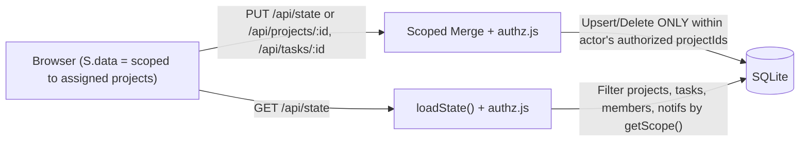

# 06 — Project-Scoped Isolation (Confidential Projects) — Review & Plan

> This document covers the architectural review, security findings, and the completed 5-phase implementation for strict project-level isolation.

## 1. Goal (what "done" means)

| Actor                               | Can see / do                                                                                                                                                                                                                                             |
| ----------------------------------- | -------------------------------------------------------------------------------------------------------------------------------------------------------------------------------------------------------------------------------------------------------- |
| **Owner / Admin** (workspace level) | Every project, member and team. The only roles that can add users to a project or remove them.                                                                                                                                                           |
| **Member / Guest** (project scoped) | Only the projects they are assigned to, plus those projects' tasks, subtasks, comments, files, events, activity and saved views. Only the people who share at least one project with them. Nothing else, not even the names or counts of other projects. |

Rule: **deny by default, enforced on the server**. The client only hides things for convenience. It is never the security boundary.

---

## 2. How the code worked before vs. now

---

## 3. Findings Addressed

### 🔴 Critical

| #   | Finding                                           | Resolution                                                                                                                                                                      |
| --- | ------------------------------------------------- | ------------------------------------------------------------------------------------------------------------------------------------------------------------------------------- |
| C1  | **Members saw every project.**                    | `loadState` now filters `projects` using `canReadProject(scope, p.id)` so non-admins only receive projects they are explicitly assigned to.                                     |
| C2  | **Any user could overwrite the whole workspace.** | `writeFullStateTx` now performs a project-scoped merge and ignores non-admin attempts to create/delete projects, alter membership/permissions, or modify out-of-scope rows.     |
| C3  | **Data-loss bug on save.**                        | Removed global `DELETE FROM <table>` wipes in `writeFullStateTx`. Saving state from a scoped user no longer deletes tasks, comments, files, events, or views of other projects. |
| C4  | **Full member directory went to everyone.**       | `redactMemberForScope` filters members to co-members + Owners/Admins and redacts emails for non-admins.                                                                         |
| C5  | **Notifications had no recipient.**               | Added `recipient_id` column and index to `notifications`; sign-up approval notifications go only to active Owners/Admins.                                                       |

### 🟠 High

| #   | Finding                                                                           | Resolution                                                                                                       |
| --- | --------------------------------------------------------------------------------- | ---------------------------------------------------------------------------------------------------------------- |
| H1  | Rows with a `NULL` project passed every filter.                                   | Dropped `NULL` project pass-through for non-admins across tasks, activity, files, events, and saved views.       |
| H2  | `recentSearches` and `notifPrefs` were shared across the workspace.               | Stored per user in `user_preferences` (`_recentSearches`, `_notifPrefs`, `_collapsed`).                          |
| H3  | Any user could share a project or invite Guests.                                  | Restricted project sharing, member assignment, and invitations to `Owner` and `Admin` on both server and client. |
| H4  | Assignee, mention, and filter pickers listed all workspace members.               | Scoped pickers to `projectMembers(projectId)` and `visibleMembers()`.                                            |
| H5  | Members, Teams, Overview, Search, and Settings pages listed all people and teams. | Scoped directory, overview, search, and settings to visible co-members; hid Teams completely from non-admins.    |
| H6  | Cross-project task dependencies and non-member assignees were allowed.            | Server validates that task/subtask assignees belong to the project and drops cross-project dependencies.         |
| H7  | Unauthenticated `/api/state` access when `setupRequired` was true.                | Closed `/api/state` and `/api/auth/*` management routes to require an authenticated session.                     |

---

## 4. Phased Implementation Status

| Phase                            | Status  | Scope                                                                                                                                                                                                                                                                                                                                                                                                                                                    | Exit criteria                                                                                                         |
| -------------------------------- | ------- | -------------------------------------------------------------------------------------------------------------------------------------------------------------------------------------------------------------------------------------------------------------------------------------------------------------------------------------------------------------------------------------------------------------------------------------------------------- | --------------------------------------------------------------------------------------------------------------------- |
| **0. Safety net**                | ✅ Done | Backed up `data/*.sqlite`. Added `node:test` suite ([isolation.test.js](../tests/isolation.test.js)) covering two confidential projects and four roles.                                                                                                                                                                                                                                                                                                  | Reproduces and verifies C1–C5, H1–H3, H6, H7.                                                                         |
| **1. Read isolation**            | ✅ Done | Created [authz.js](../server/authz.js), scoped `loadState` in [db.js](../server/db.js), redacted member emails, hid teams for non-admins, added `recipient_id` to notifications, moved `recentSearches`/`notifPrefs` to per-user `user_preferences`, and closed the unauthenticated `setupRequired` `/api/state` path in [api.js](../server/api.js).                                                                                                     | A Member's `GET /api/state` contains zero IDs from foreign projects or users.                                         |
| **2. Write isolation (Stage A)** | ✅ Done | Replaced `DELETE FROM <table>` wipes in `writeFullStateTx` ([db.js](../server/db.js)) with project-scoped merges; locked project creation/deletion and membership/permission changes to Owner/Admin; validated task/subtask assignees and same-project dependencies.                                                                                                                                                                                     | Tampered PUT payloads cannot read, create, change or delete data outside the user's scope. C3 data-loss bug is fixed. |
| **3. Admin assignment UX**       | ✅ Done | Added `/api/admin/projects/:id/members`, `/api/admin/members/:id/projects`, and `/api/admin/isolation-report` in [api.js](../server/api.js) & [db.js](../server/db.js); added admin "Project access" assignment panel on member profiles ([members.js](../src/pages/members.js)), admin-only Share modal controls ([modals.js](../src/overlays/modals.js)), and an Isolation Report in Settings → Permissions ([settings.js](../src/pages/settings.js)). | An admin can assign or unassign users, and the change takes effect on the user's next fetch.                          |
| **4. Client scoping polish**     | ✅ Done | Scoped `canSee`, `canCreateProject`, `canInvite`, `projectMembers`, `visibleMembers`, and `teamsList` in [store.js](../src/core/store.js); scoped assignee/mention/filter pickers, sidebar, search, command palette, overview, and added `syncOnFocus` in [main.js](../src/main.js).                                                                                                                                                                     | No UI surface shows foreign people or projects.                                                                       |
| **5. Granular API (Stage B)**    | ✅ Done | Added `/api/projects`, `/api/projects/:id`, `/api/tasks`, `/api/tasks/:id`, and `/api/tasks/:id/comments` in [api.js](../server/api.js) & [db.js](../server/db.js) with non-enumerable `404` responses for out-of-scope projects/tasks and per-action audit logging.                                                                                                                                                                                     | Granular endpoints enforce `authz` and return `404` for out-of-scope resources.                                       |
